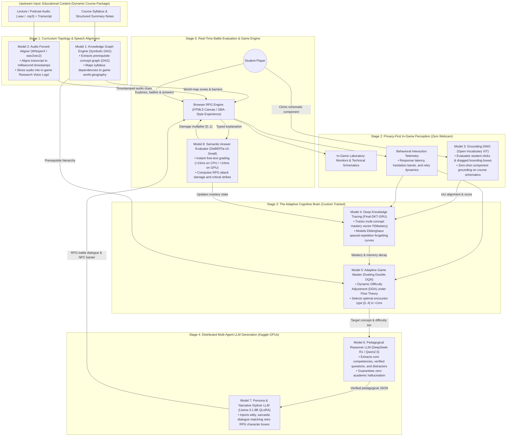

# Adaptive E-Learning RPG — Intelligent Tutoring Platform

An AI-powered adaptive educational RPG developed in vanilla HTML5/Canvas/JavaScript paired with a local, multi-model PyTorch AI backend. The platform transforms academic course material into an interactive retro adventure where learning occurs through exploration, adaptive turn-based battles, and interactive visual investigations.

The system operates **100% locally with zero webcam surveillance**, preserving full learner privacy (GDPR/FERPA compliant) by modeling cognitive mastery, memory decay, and engagement strictly through in-game behavioral telemetry.

---

## 1. End-to-End System Architecture

The platform connects upstream course material (notes, textbook summaries, and audio lectures) to a closed-loop, multi-tier AI game engine:



---

## 2. Model Overview & Benchmark Results

The platform deploys specialized machine learning models chosen through empirical benchmarking rather than generic wrappers:

### Model 1: Cognitive Knowledge Tracer (`Final-DKT-GRU`)
* **Role**: Tracks latent concept mastery over time and predicts memory decay to trigger spaced-repetition encounters before concepts are forgotten.
* **Architecture**: 2-layer Context-Aware LayerNorm GRU (`hidden_dim = 128`, `dropout = 0.25`) with a 13-dimensional behavioral telemetry encoder (log latency, rapid-guess `<5s`, flow `5-15s`, deliberate `15-60s`, struggle `>60s`, retry counts, scaffold usage, answer format) and dual concept-fusion prediction heads.
* **Trained On**: ASSISTments Benchmark (`432,928` clean interaction sequences across `123` skills).
* **Benchmark Results**:
  * **Test ROC-AUC**: **`0.7996`** (outperforming baseline `DKT-LSTM` at `0.7732` and standard `DKT-GRU` at `0.7754`).
  * **Test Accuracy**: **`74.43%`**.
  * **Anti-Guessing Calibration**: Distinguishes rapid lucky guesses (`61.0%` mastery update) from deliberate, reasoned answers (`85.3%`).
  * **Inference Speed**: **`2.37 ms`** on CPU.

### Model 2: Pedagogical Game Master (`Dueling Double-DQN`)
* **Role**: Dynamic Difficulty Adjustment (DDA). Reads the student's cognitive state and behavioral affect to choose the optimal learning intervention according to Csikszentmihalyi's Flow Theory.
* **Architecture**: Dueling Deep Q-Network separating State Value $V(s)$ and Advantage $A(s, a)$ streams over a 12-dimensional student state space (target mastery, prerequisite deficit, fail streak, win streak, frustration, boredom, overall mastery, turn progress, concept context).
* **Action Space**:
  * `[0]` Audio Hint + Scaffolded Quiz (rescues frustrated/tilted learners).
  * `[1]` Easy Recall Wild Encounter (builds early confidence).
  * `[2]` Medium Flow Trainer Battle (sustains optimal challenge).
  * `[3]` Prerequisite Review Battle (remediates foundation gaps).
  * `[4]` Hard Open-Text Boss Synthesis Challenge (unlocks concept badges).
* **Calibrated On**: **`6,123,270` rows (`2.80 GB`)** of empirical student affective interaction logs.
* **Benchmark Results**:
  * **Mean Evaluation Reward**: **`+19.23`** (outperforming random policy at `13.41`, static medium at `18.80`, standard DQN at `18.42`, and PPO at `18.91`).
  * **Affective Metrics**: Highest student focus (**`85.54%`**), lowest frustration (**`29.28%`**), and lowest boredom (**`11.90%`**).
  * **Decision Speed**: **`0.258 ms`** on CPU.

### Model 3: Semantic Answer Evaluator (`DeBERTa-v3-Small`)
* **Role**: Evaluates open-ended, free-text student explanations during boss encounters and tactical attacks, scoring conceptual equivalence against reference summaries in real time.
* **Architecture**: Cross-Encoder transformer (`microsoft/deberta-v3-small`, `142.5M` parameters) with a 3-way classification head (`correct`, `partial`, `incorrect`) and continuous score calibration.
* **Trained On**: Master dataset of **`99,631` pairs** unifying classroom student answers (`SciEntsBank`, `Beetle`), natural language inference (`MultiNLI`), semantic similarity (`STS-B`), and adversarial word swaps (`Google PAWS`).
* **Benchmark Results**:
  * **3-Way Accuracy**: **`79.84%`** (vs. keyword overlap baseline at `39.95%` and MiniLM at `77.17%`).
  * **Binary ROC-AUC**: **`0.9241`**.
  * **Adversarial PAWS Trap Accuracy**: **`93.61%`** (resists negation tricks and inverted cause-effect traps where word overlap exceeds 90%).
  * **Latency**: **`10.2 ms`** on GPU / **`<25 ms`** on CPU.

### Model 4: In-Game Diagram Vision Evaluator (`Grounding DINO Tiny`)
* **Role**: Evaluates interactive visual investigations on laboratory monitors and technical schematics without requiring camera access.
* **Architecture**: Open-Vocabulary Vision Transformer (`IDEA-Research/grounding-dino-tiny`, `172.3M` parameters) running zero-shot grounded object detection on course diagrams.
* **Benchmark Results**:
  * **Audit Success**: **`30/30` scenarios passed (`100.0%`)** across click precision, dragged bounding-box IoU, and distractor rejection.
  * **Mean Dragged-Box IoU**: **`0.894`**.
  * **Latency**: **`522 ms`** on CUDA.

---

## 3. Codebase Structure

```
.
├── server.py                                # Local multi-model HTTP API server & static host
├── index.html                               # Game entry point (runs via server or file://)
├── validate.js                              # Data integrity gate (map bounds, collision, warps)
├── extract_firered_battle_assets.py         # Deterministic GBA sprite & arena asset extractor
│
├── js/                                      # Browser RPG Client Engine
│   ├── main.js                              # Game loop, adaptive viewport scaling, PWA lifecycle
│   ├── overworld.js                         # Tile engine, grid movement, 4-way LOS trainers, warps
│   ├── battle.js                            # GBA combat engine, catch formula, particle animations
│   ├── ui.js                                # GBA dialogue boxes, tactical selectors, Grounding DINO modal
│   ├── ai_tutor.js                          # Client-side AI bridge & offline curriculum fallback
│   ├── audio.js                             # Web Audio chiptune & battle SFX synthesis
│   ├── save.js                              # LocalStorage slot & portable base64 save codes
│   └── data/                                # Game registries (types, moves, species, maps, sprites)
│
├── Models/                                  # Machine Learning Subsystems
│   ├── DKT/                                 # Model #1: Deep Knowledge Tracing
│   │   ├── checkpoints/                     # best_final_gru_model.pt, skill_mapping.json
│   │   ├── scripts/                         # dataset.py, model.py, train_final_gru.py, test_final_gru.py
│   │   ├── results/                         # models_summary.csv, training logs
│   │   └── eda.py                           # ASSISTments forensic exploratory data analysis
│   │
│   ├── RL/                                  # Model #2: Pedagogical Game Master
│   │   ├── checkpoints/                     # double_dqn_gamemaster.pt, ppo_gamemaster.pt
│   │   ├── scripts/                         # student_env.py, models.py, train_final_dqn.py, test_rl_gamemaster.py
│   │   ├── results/                         # rl_models_summary.csv, training logs
│   │   └── eda_affective.py                 # Affective calibration & telemetry dynamics
│   │
│   ├── AnswerEvaluator/                     # Model #3: Semantic Answer Evaluator
│   │   ├── checkpoints/                     # deberta_v3_grader.pt, tokenizers
│   │   ├── scripts/                         # grader_dataset.py, grader_models.py, train_deberta.py, test_answer_grader.py
│   │   ├── results/                         # grader_models_summary.csv, training logs
│   │   ├── download_dataset.py              # Multi-domain benchmark fetcher & merger
│   │   └── eda.py                           # Text length & semantic overlap analysis
│   │
│   ├── GroundingDINO/                       # Model #4: In-Game Diagram Vision Grounding
│   │   ├── checkpoints/                     # Local grounding_dino_tiny weights
│   │   ├── scripts/                         # dino_evaluator.py, generate_course_diagrams.py, test_grounding_dino.py
│   │   ├── data/                            # diagram_puzzles.json
│   │   └── results/                         # grounding_dino_summary.csv
│   │
│   ├── engine/                              # AI Integration Layer
│   │   ├── knowledgequest_engine.py         # Master closed-loop orchestrator (<30ms/turn)
│   │   └── curriculum_bank.py               # Prerequisite DAG & dynamic course loader
│   │
│   └── test_integrated_pipeline.py         # End-to-end multi-model integration test & terminal RPG
│
├── course_material/                         # Dynamic Course Packages
│   └── generate_podcast_audio.py            # Local TTS generator for 15-second audio hint clips
│
└── assets/                                  # Local Game Graphics & Audio
    ├── battle/                              # Arenas, sliding platforms, Red 5-frame throw, Poké Balls
    ├── overworld/                           # Tilesets, building decals, character walk sheets
    ├── sprites/                             # 64x64 creature front/back & shiny variants
    └── fx/                                  # 35 move animation strips, stat waves, type badges
```

---

## 4. Execution & Verification Guide

### Prerequisites
* Windows, macOS, or Linux.
* Python 3.10+ with CUDA support (CPU fallback is automatically supported).
* Node.js (for asset downloads and validation checks).

```powershell
# 1. Clone repository and activate environment
git clone https://github.com/zaabola/E-Learning.git -b interactive_learning_RPG
cd E-Learning
python -m venv .venv
.\.venv\Scripts\activate

# 2. Install dependencies
pip install torch torchvision --index-url https://download.pytorch.org/whl/cu124
pip install transformers datasets scikit-learn numpy pillow pyttsx3
```

---

### Running the Live Platform

Launch the local server hosting the browser RPG and REST endpoints:

```powershell
.\.venv\Scripts\python.exe server.py --open
```

* The server initializes all local PyTorch checkpoints (`Final-DKT-GRU`, `Double-DQN`, `DeBERTa-v3-Small`, and `Grounding-DINO-Tiny`).
* The game opens in your browser at `http://127.0.0.1:8000`.
* **Offline Resilience**: The RPG can also be played standalone without starting `server.py` by opening `index.html` directly via `file://` — `js/ai_tutor.js` provides client-side rule evaluation.

---

### Running Diagnostic & Verification Tests

Every model and subsystem includes a standalone verification script:

```powershell
# 1. End-to-End Multi-Model Closed-Loop Pipeline Test
.\.venv\Scripts\python.exe Models/test_integrated_pipeline.py --auto

# 2. Model #1 (DKT) Behavioral Sanity & Mastery Simulator
.\.venv\Scripts\python.exe Models/DKT/scripts/test_final_gru.py

# 3. Model #2 (RL Game Master) Policy & Q-Value Diagnostics
.\.venv\Scripts\python.exe Models/RL/scripts/test_rl_gamemaster.py

# 4. Model #3 (Semantic Grader) Adversarial Negation & Trap Audit
.\.venv\Scripts\python.exe Models/AnswerEvaluator/scripts/test_answer_grader.py --auto

# 5. Model #4 (Grounding DINO) Diagram Puzzle IoU Benchmark
.\.venv\Scripts\python.exe Models/GroundingDINO/scripts/test_grounding_dino.py

# 6. Frontend Game Data Integrity Check
node validate.js
```

---

## 5. Gameplay Mechanics & Progression

### Controls

| Key | Overworld Action | Battle Action |
| :--- | :--- | :--- |
| **Arrows / WASD** | Move character (grid movement) | Navigate menus / select moves |
| **Z / Space** | Confirm / talk / interact with consoles | Confirm move / advance dialogue |
| **X / Esc / Backspace** | Cancel / close modal | Return to move select |
| **Enter** | Open Start Menu | Confirm selection |
| **T** | — | Switch from multiple-choice to **Open-Text Typing** |
| **H** | — | Play **Spoken Podcast Audio Hint** |
| **M** | Toggle chiptune sound & SFX | Toggle audio |
| **F** | Toggle browser fullscreen | Toggle browser fullscreen |

* **Mobile Support**: On touch devices (coarse pointer, landscape orientation), an in-game semi-transparent D-pad, A/B buttons, and a START pill overlay appear automatically.

---

### Core Gameplay Loops

#### 1. Exploration & Overworld Interactions
* Navigate a 16px tile-based world with smooth collision, map-link warps, and animated walk cycles.
* **Line-of-Sight (LOS) Trainers**: Trainers scan all four directions; entering their field of view triggers dialogue and initiates an educational battle.
* **Laboratory Computer Consoles**: Inspecting consoles (`tile 'H'`) boots the **Grounding DINO Visual Calibration Terminal**, loading technical schematics directly from course material.
* **Research Audio Bookshelves**: Inspecting bookshelves (`tile 'k'`) plays timestamped 15-second audio logs cut from the course podcast.

#### 2. Adaptive Turn-Based Battles
* **Authentic Combat Choreography**: Split-scanline curtain wipes, arena platforms, 5-frame trainer throw sequences, entry hops, 35 move-effect strips, and scrolling stat-boost chevron waves.
* **Combat Damage Driven by Pedagogy**:
  * Choosing the correct move or submitting an accurate open-text explanation triggers a **Critical Hit** (dealing up to $1.35\times$ damage).
  * Submitting a partial answer deals a glancing blow ($0.5\times$ damage).
  * Submitting an incorrect answer or falling for an adversarial trap causes the move to fizzle, giving the opponent a counter-attack window.
* **Gen-3 Combat & Catch Mechanics**: Full 17-type effectiveness chart, STAB multipliers, accuracy/evasion stages, status conditions (sleep, paralysis, burn, poison, confusion), 3-shake Poké Ball capture calculations, and party-wide EXP distribution.

#### 3. Flow State & Dynamic Difficulty Adjustment
During gameplay, the **Double-DQN Game Master** continuously evaluates student cognitive metrics:
* If the learner shows signs of struggle or frustration (fail streak $\ge 2$), the Game Master triggers **Action [0] (Audio Hint + Scaffold)** or **Action [3] (Prerequisite Remediation)**.
* When the student enters Flow with steady mastery, the Game Master deploys **Action [2] (Trainer Flow Battle)**.
* When concept mastery reaches $\ge 68\%$, the Game Master initiates **Action [4] (Open-Text Boss Synthesis Challenge)**, evaluated live by `DeBERTa-v3-Small`. A successful explanation awards the **`★` Concept Synthesis Badge**.

#### 4. The Field Journal (`ENTER -> JOURNAL`)
* **Tab 1 — Mastery & Affect**: Displays real-time DKT mastery bars across curriculum concepts, earned Concept Badges, and telemetry-derived Focus/Frustration/Boredom gauges.
* **Tab 2 — Study Notes**: Scrollable syllabus bullet points and on-demand playback of 15-second audio lecture clips.
* **Tab 3 — AI Lab & Grounding DINO**: Model status inspector and direct launcher for the Grounding DINO diagram puzzle suite.

---

## 6. Dynamic Course Integration

The platform is content-agnostic. Rather than being tied to a single subject, courses are defined as structured packages:

```json
{
  "course_id": "course_identifier",
  "title": "Course Name",
  "concepts": [
    {
      "concept_id": 0,
      "title": "Foundational Concept",
      "prereqs": [],
      "podcast_audio": "audio/hint_c0.wav",
      "podcast_hint": "Spoken key takeaway...",
      "summary_bullets": ["Bullet 1", "Bullet 2"],
      "easy_mc": [{ "question": "...", "choices": ["..."], "correct_idx": 0 }],
      "boss_open": [{ "question": "...", "reference": "..." }]
    }
  ]
}
```

New syllabus materials processed by upstream pipelines (summaries, extracted prerequisite graphs, and aligned audio snippets) can be loaded into `course_material/` and registered with `curriculum_bank.py` to generate new game worlds, puzzles, and battle campaigns dynamically.
