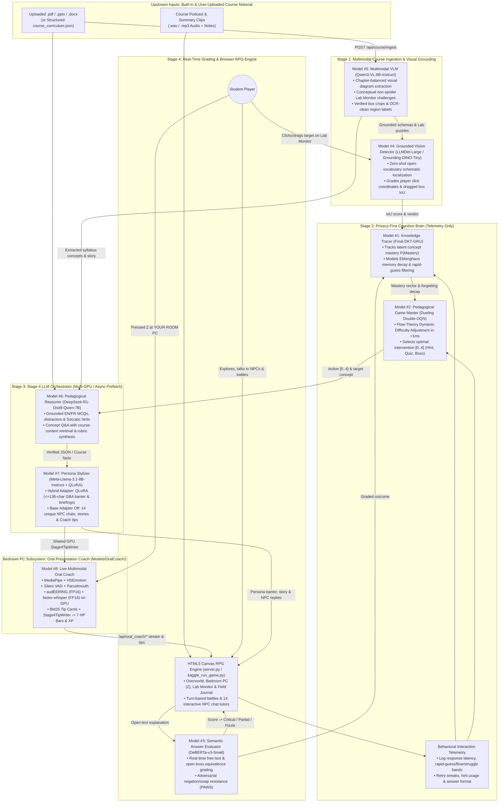

# Adaptive E-Learning RPG — 7-Model Intelligent Tutoring & Oral Coach Platform

An AI-powered adaptive educational RPG built in **vanilla HTML5 / Canvas / JavaScript** (zero build tools) paired with a **PyTorch Multi-Model AI backend** and a live multimodal **Oral Presentation Coach (`Models/OralCoach/`)**. The platform transforms arbitrary academic courses—including live uploaded `.pdf`, `.pptx`, and `.docx` documents—into an interactive GBA-style monster-catching adventure with grounded diagram puzzles, adaptive turn-based quiz battles, **14 unique interactive LLM NPCs**, and live oral presentation coaching accessed from the PC in the player's room.

* **Core Adaptive Tutoring Loop (Models `#1–#7`)**: Runs privacy-first with **zero webcam or microphone surveillance** (GDPR/FERPA compliant), inferring mastery, memory decay, and affective states strictly from in-game behavioral telemetry.
* **Opt-In Oral Presentation Coach (`Model #8` / Bedroom PC)**: Activates browser webcam and microphone capture strictly while the player opens the `ORAL COACH PC` modal in `YOUR ROOM` (or localhost `run.py`), and immediately releases all media tracks on close.

---

## 1. End-to-End Multi-Model System Architecture



---

## 2. Model Overview & Empirical Benchmark Results

Every component in the pipeline is benchmarked individually and end-to-end rather than relying on unverified prompts:

### Model #1: Cognitive Knowledge Tracer (`Final-DKT-GRU`)
* **Role**: Tracks latent mastery per syllabus concept and models Ebbinghaus-style memory decay to schedule spaced-repetition encounters.
* **Architecture**: 2-layer Context-Aware LayerNorm GRU (`hidden_dim = 128`, `dropout = 0.25`, `582,913` parameters) with a 13-dimensional behavioral telemetry encoder (log latency, rapid-guess `<5s`, flow `5–15s`, deliberate `15–60s`, struggle `>60s`, retry counts, scaffold usage, format).
* **Trained On**: ASSISTments Benchmark (`432,928` clean interaction sequences across `123` skills).
* **Benchmark Results** (`Models/DKT/results/models_summary.csv`):
  * **Test ROC-AUC**: **`0.7996`** (outperforming `DKT-LSTM` at `0.7732` and standard `DKT-GRU` at `0.7754`).
  * **Test Accuracy**: **`74.43%`**.
  * **Anti-Guessing Calibration**: Distinguishes rapid lucky guesses (`61.0%` mastery update) from deliberate reasoned answers (`85.3%`).
  * **Inference Speed**: **`2.37 ms`** on CPU.

### Model #2: Pedagogical Game Master (`Dueling Double-DQN`)
* **Role**: Dynamic Difficulty Adjustment (DDA) grounded in Csikszentmihalyi's Flow Theory.
* **Architecture**: Dueling Deep Q-Network (`35,590` parameters) separating State Value $V(s)$ and Advantage $A(s,a)$ over a 12-dimensional student cognitive/affective state vector.
* **Action Space (`[0..4]`)**:
  * `[0]` Audio Hint + Scaffolded Quiz (rescues frustrated or stalled learners).
  * `[1]` Easy Recall Wild Encounter (builds baseline confidence).
  * `[2]` Medium Flow Trainer Battle (sustains optimal challenge).
  * `[3]` Prerequisite Review Battle (remediates foundation gaps).
  * `[4]` Hard Open-Text Boss Synthesis Challenge (awards Concept Mastery Stars).
* **Calibrated On**: **`6,123,270` rows (`2.80 GB`)** of empirical student affective interaction logs (`Models/RL/results/rl_models_summary.csv`).
* **Benchmark Results**:
  * **Mean Evaluation Reward**: **`+19.23`** (`19.2348`, outperforming Random at `13.41`, Static Medium at `18.80`, Final-Double-DQN at `18.42`, and PPO-ActorCritic at `18.91`).
  * **Affective Metrics**: Highest learner concentration (**`85.54%`**), lowest frustration (**`29.28%`**), and lowest boredom (**`11.90%`**).
  * **Decision Speed**: **`0.258 ms`** on CPU.

### Model #3: Semantic Answer Evaluator (`DeBERTa-v3-Small`)
* **Role**: Grades open-ended student explanations submitted during tactical attacks (`[T] Own Words`) and Boss Synthesis encounters (`Action [4]`).
* **Architecture**: Cross-Encoder (`microsoft/deberta-v3-small`, `142,490,884` / `142.5M` parameters) outputting 3-way probabilities (`correct`, `partial`, `incorrect`) and continuous semantic equivalence scores.
* **Trained On**: **`99,631` pairs** across `SciEntsBank`, `Beetle`, `MultiNLI`, `STS-B`, and adversarial `Google PAWS`.
* **Benchmark Results** (`Models/AnswerEvaluator/results/grader_models_summary.csv`):
  * **3-Way Accuracy**: **`79.84%`** (vs. keyword overlap baseline at `39.95%` and `MiniLM-L12-H384` at `77.17%`).
  * **Binary ROC-AUC**: **`0.9241`**.
  * **Adversarial PAWS Trap Accuracy**: **`93.61%`** (resists negation flips and inverted cause-effect phrasing).
  * **Latency**: **`10.2 ms`** on GPU / **`<25 ms`** on CPU.

### Model #4: In-Game Diagram Vision Evaluator (`LLMDet-Large` / `Grounding-DINO-Tiny`)
* **Role**: Grades interactive visual inspections on the Laboratory Calibration Terminal (`Lab Monitor`) from student mouse clicks or dragged bounding boxes.
* **Architecture**:
  * **Kaggle / `>=10 GB` VRAM**: Auto-loads `iSEE-Laboratory/llmdet_large` (`343,055,703` params, CVPR 2025 Swin-Large) with automatic fallback to `IDEA-Research/grounding-dino-base` → `IDEA-Research/grounding-dino-tiny`.
  * **Local 4 GB GPU / CPU**: Loads `IDEA-Research/grounding-dino-tiny` (`172,250,626` params) offline from `Models/GroundingDINO/checkpoints/`.
  * Includes dot-free label sanitization (`sanitize_dino_labels()` for `MMGroundingDinoProcessor`) and multi-occurrence `valid_boxes` IoU scoring (`iou >= 0.35`, or center-inside box with `iou >= 0.18`).
* **Benchmark Results** (`Models/GroundingDINO/results/grounding_dino_summary.csv`):
  * **Audit Scenarios**: **`30/30` expected verdicts (`100.0%`)** across `10` technical diagram puzzles × `3` test cases (center click, dragged bounding box, distractor click).
  * **Mean Dragged-Box IoU**: **`0.894`** (range `0.8322–0.9220`).
  * **Mean CUDA Latency**: **`523 ms`** (range `517.83–526.95 ms`).

### Model #5: Multimodal Course & Diagram VLM (`Qwen/Qwen3-VL-8B-Instruct`)
* **Role**: Powers live `.pdf` / `.pptx` / `.docx` ingestion (`custom_course_ingestor.py`), high-resolution schematic grounding, non-spoiler Lab Monitor challenge generation (`_question_leaks_label()` anti-leak filter), and VLM-verified bounding-box refinement (`verify_box_contains_label_live()`).
* **Architecture & Precision**:
  * Loaded on Kaggle in **4-bit NF4** for the language backbone with **FP16 vision & merger layers** (`llm_int8_skip_modules=["visual", "model.visual", "merger", "deepstack_merger_list", "multi_modal_projector", "lm_head"]`), pinned to **`cuda:1`** (`5,294,239,984` packed parameters).
  * Fallback chain: `Qwen/Qwen3-VL-8B-Instruct` → `Qwen/Qwen2.5-VL-7B-Instruct` → `Qwen/Qwen2-VL-7B-Instruct`.
  * Local PCs automatically run `mode="hybrid"`, serving pre-extracted diagram caches (`Models/VLM/data/vlm_extracted_diagrams.json`).
* **Benchmark Results** (`Models/VLM/results/vlm_benchmark_summary.csv`, `10` diagram components `c0_p1`..`c4_p2`):
  * **Mean Standalone VLM IoU**: **`0.979`** (range `0.9671–0.9848`).
  * **Mean Fused VLM + DINO IoU**: **`0.993`** (range `0.9834–0.9963`).
  * **Mean DeBERTa VQA Verification Gap**: Correct VQA score **`0.988`** vs. Distractor Trap **`0.008`** (**`0.980`** mean separation gap, range `0.9708–0.9845`).

### Model #6: Pedagogical Reasoner LLM (`DeepSeek-R1-Distill-Qwen-7B`)
* **Role**: Generates course-grounded multiple-choice questions (`4` unique choices + shuffled `correct_idx`), Socratic hints, Open-Text Boss Synthesis rubrics, and retrieval-grounded answers (`answer_course_question()`) when players ask NPCs about uploaded or built-in course materials.
* **Architecture**: `deepseek-ai/DeepSeek-R1-Distill-Qwen-7B` in **4-bit NF4** pinned to **`cuda:0`** (`4,352,972,288` packed parameters), with fallback to `Qwen/Qwen2.5-7B-Instruct` → `Qwen/Qwen2.5-3B-Instruct` → curriculum bank. Uses closed-`<think>` prefill (`max_new_tokens=340`), `strip_think_trace()`, strict JSON extraction, and bilingual EN/FR matching.
* **Diagnostic Audit** (`evaluate_stage4_llms.py`, `10` cases across RL Tiers `0..4` EN/FR): **`70.0%`** strict JSON validity and `25.32s` mean latency on initial un-prefilled Kaggle audit (subsequently optimized via closed-`<think>` prefill to skip runaway chain-of-thought traces).

### Model #7: Retro-GBA Persona Stylizer (`Meta-Llama-3.1-8B-Instruct` + QLoRA)
* **Role**: Generates in-character RPG banter, Prof. Ada briefings, custom course opening storylines (`generate_course_story()`), and bilingual open-ended chat across all **14 unique town & gym NPCs**, and powers live `Stage4TipWriter` presentation tips for the Oral Coach.
* **Custom Fine-Tuning (`train_persona_qlora.py`)**:
  * **Dataset (`build_persona_dataset.py`)**: `419` bilingual EN/FR examples (`311 train / 48 val / 60 test`), formatted with assistant-only loss masking so gradients update exclusively on persona responses.
  * **LoRA Config**: `r = 16`, `alpha = 32`, NF4 4-bit base (`4,582,543,360` packed params), **`41,943,040` trainable parameters (`0.915%`)**, `3` epochs (`1606.7s` total on Kaggle T4).
  * **Hybrid Adapter Runtime Switching (`_base_model_ctx()`)**: Keeps the trained QLoRA adapter active for strict JSON GBA battle banter (`<=136` chars) and Prof. Ada briefings, while dynamically disabling the adapter (`model.disable_adapter()`) for conversational 14-NPC Q&A (`_detect_user_language()`), PDF storyline generation, and Oral Coach tip wording.

#### Observed QLoRA Training Progression (Validation Set `n = 48`)

| Stage | Train Loss | Val Loss | Val Perplexity (PPL) | Epoch Time |
| :--- | :---: | :---: | :---: | :---: |
| **Baseline (Pre-training)** | — | `2.3933` | `10.95` | — |
| **Epoch 1** | `0.8423` | `0.1444` | `1.16` | `536.3s` |
| **Epoch 2** | `0.0589` | `0.0414` | `1.04` | `533.3s` |
| **Epoch 3 (Final)** | **`0.0281`** | **`0.0322`** | **`1.03` (-90.6%)** | `534.0s` |

#### Observed Held-Out Test Comparison (`test = 60` PPL / `n = 24` Generative Audit)

| Metric | Base `Meta-Llama-3.1-8B` | Fine-Tuned QLoRA (`r=16, alpha=32`) | Improvement |
| :--- | :---: | :---: | :---: |
| **Held-Out Test Loss** | `2.3804` | **`0.0400`** | **-98.3%** |
| **Held-Out Test PPL** | `10.81` (`10.809`) | **`1.04`** (`1.041`) | **-90.4%** |
| **Strict JSON Validity** | `91.67%` | **`100.0%`** | **+8.33 pts** |
| **GBA Box Compliance (`<=136 chars`)** | `0.0%` | **`100.0%`** | **+100.0 pts** |
| **Mean Generation Latency** | `5.43s` | `14.48s` | Budgeted via async prefetch |

---

### Model #8: Live Multimodal Oral Presentation Coach (`Models/OralCoach/`)
* **Role**: Interactive real-time presentation coach integrated into the bedroom PC (`YOUR ROOM`), analyzing live speaking clarity, eye contact, vocal prosody, pacing, filler words, and affective confidence while coaching students on their weakest curriculum concept.
* **Multimodal Sensor Stack**:
  * **Face & Eye Contact**: `MediaPipe FaceLandmarker` (`face_landmarker.task` — gaze blendshapes, yaw/pitch head pose, smiles, blinks) + `HSEmotion` (`enet_b0_8_va_mtl` 8 emotions + valence/arousal).
  * **Voice & Speech**: `Silero VAD` (`512`-sample `16 kHz` streaming blocks via `BrowserAudioSource`), `Praat Parselmouth` (semitone pitch & intonation variance), `audEERING wav2vec2-large-robust-12-ft-emotion-msp-dim` (vocal arousal/dominance/valence in **FP16** on GPU), and `faster-whisper` (`small`/`base` in **FP16** with automatic **CPU `int8`** fallback).
* **Coaching & Recommendation Loop (`coach/recommend/`)**:
  * Calibrates for the first `30s` of speech (`Baseline`), then computes 7 normalized channels (`stress`, `confidence`, `energy`, `positivity`, `eye_contact`, `expressiveness`, `pace` WPM) plus `fillers_per_min`.
  * Detects sustained patterns (`patterns.py`, `more_patterns.py`) and urgent fast-lane events (`urgent.py`: freeze, panic, stress spike, lost audience), retrieves cited advice cards (`knowledge/cards/`) with BM25 (`knowledge.py`), rewrites concise tips via **`Stage4TipWriter`** (or Ollama / Claude / cited card template fallback), runs `did-it-help` post-tip recovery checks (`coach.py`), awards **Oral XP & Levels** (`GameFeel`), and logs every session to `Models/OralCoach/logs/session-*.jsonl`.

---

### Kaggle `2× Tesla T4` Multi-GPU VRAM Placement

When booted on Kaggle (`2 × 16 GB T4`), `server.py` / `kaggle_run_game.py` shards the RPG models and places Oral Coach components intelligently:

| GPU Device | Assigned Models | Quantization / Precision | Notes |
| :--- | :--- | :--- | :--- |
| **`cuda:0` (`~15 GiB`)** | `DeepSeek-R1-Distill-Qwen-7B` + `LLMDet-Large` + `Meta-Llama-3.1-8B` Shard 0 | 4-bit NF4 (`LLM`), FP32/FP16 (`DINO`) | Shared by Stage-4 RPG + `Stage4TipWriter` |
| **`cuda:1` (`~15 GiB`)** | `Qwen3-VL-8B-Instruct` + `Meta-Llama-3.1-8B` Shard 1 + **Oral Coach (`audEERING`, `faster-whisper`)** | 4-bit NF4 VLM/LLM + FP16 Vision & Audio | `_pick_best_cuda_device()` picks highest free VRAM (`>=1.8 GiB`); CPU fallback if tighter |
| **`cuda` / `CPU`** | `Final-DKT-GRU`, `Dueling Double-DQN`, `DeBERTa-v3-Small`, `MediaPipe`, `HSEmotion`, `Silero VAD`, `Parselmouth` | FP32 / ONNX / CPU | Interactive sessions pause Stage-4 prefetch (`set_vlm_busy(True)`) & clear CUDA cache on stop |

Interactive requests also signal `_interactive_pending` in `Stage4LLMOrchestrator` so background `RL [0..4]` encounter prefetching immediately yields GPU compute to live player NPC chats.

---

## 3. Codebase Structure

```text
DL-Interactive_L/
├── index.html                           # Browser entry point & script dependency order
├── server.py                            # Local HTTP server + full AI & Oral Coach REST API (/api/*)
├── kaggle_run_game.py                   # Turnkey Kaggle 2x T4 launcher + Cloudflare HTTPS tunnel
├── validate.js                          # Frontend game & map data integrity check (Node.js)
├── manifest.json / sw.js                # Progressive Web App manifest & offline service worker
├── extract_firered_battle_assets.py     # Battle VFX & UI extraction utility
├── download-assets.js                   # Fetches local battle & item PNG sprites
├── download-overworld.js                # Fetches local RMXP tilesets & character walk sheets
│
├── css/
│   └── style.css                        # GBA bezels, battle/chat/ingest overlays & Oral Coach HUD
│
├── js/                                  # Vanilla HTML5 RPG Engine
│   ├── main.js                          # Title screen, 2x logical loop, adaptive viewport, custom story intro
│   ├── overworld.js                     # Grid movement, LOS trainers, bedroom PC trigger, 14 NPCs
│   ├── battle.js                        # Gen-3 combat, catch math, status VFX, adaptive quiz integration
│   ├── ui.js                            # Dialog, NPC Intel Chat, Oral Coach modal, Lab Monitor, Field Journal
│   ├── ai_tutor.js                      # Client bridge to /api/* + /api/oral_coach/* + offline JS fallback
│   ├── audio.js & save.js               # WebAudio chiptune synth + spoken clips + localStorage saves
│   └── data/                            # Tile-string maps, species, moves, items, types, assets, fallback sprites
│
├── Models/                              # AI Backend & Orchestration
│   ├── engine/
│   │   ├── knowledgequest_engine.py     # Closed-loop orchestrator (DKT -> RL -> Reasoner -> Stylizer -> DeBERTa)
│   │   └── curriculum_bank.py           # Built-in syllabus + dynamic ingested course loader
│   ├── DKT/                             # Model #1: Final-DKT-GRU (train_final_gru.py, test_final_gru.py, ckpts)
│   ├── RL/                              # Model #2: Dueling Double-DQN (train_dqn.py, student_env.py, ckpts)
│   ├── AnswerEvaluator/                 # Model #3: DeBERTa-v3-Small grader (train_deberta.py, test_answer_grader.py)
│   ├── GroundingDINO/                   # Model #4: LLMDet-Large / Grounding-DINO-Tiny (dino_evaluator.py, tests)
│   ├── VLM/                             # Model #5: Qwen3-VL-8B engine + PDF/PPTX/DOCX ingestor + Kaggle runner
│   ├── LLM/                             # Models #6 & #7: Reasoner, Persona Stylizer + QLoRA dataset/trainer/eval
│   │   ├── data/build_persona_dataset.py
│   │   ├── scripts/{pedagogical_reasoner.py,persona_stylizer.py,stage4_llm_orchestrator.py}
│   │   └── scripts/{train_persona_qlora.py,evaluate_stage4_llms.py}
│   ├── OralCoach/                       # Model #8: Live Oral Presentation Coach (integrated from oral_coach)
│   │   ├── oral_coach_service.py        # Browser JPEG/PCM streaming, GPU FP16 workers & Stage4TipWriter
│   │   ├── run.py / setup_models.py     # Standalone OpenCV desktop runner & CWD-safe weight pre-downloader
│   │   ├── requirements.txt / requirements_kaggle.txt
│   │   ├── coach/                       # Face/voice sensors, channels, BM25 recommender, GameFeel & retro HUD
│   │   └── knowledge/                   # Cited tip cards (calm, delivery, more) + sources.md
│   └── test_integrated_pipeline.py      # Full-course closed-loop audit across Models #1, #2, and #3
│
└── course_material/                     # Course Packages & Audio
    ├── generate_podcast_audio.py        # Synthesizes timestamped offline concept .wav clips
    └── vision_yolo_ocr/                 # Default syllabus JSON + structured markdown notes
```

---

## 4. Execution, QLoRA Training & Verification Guide

### Prerequisites
* Windows, macOS, or Linux (local mode) **OR** Kaggle Notebook (`GPU T4 x2`, `Internet: ON`, `Persistence: Files only`).
* Python `3.10+` with CUDA support (CPU fallback is automatic for Models `#1–#4`).
* Node.js (for `validate.js` and optional asset scripts).

---

### Option A: Local Execution (`<=4 GB` VRAM or CPU)

Runs Models `#1–#4` locally (`Final-DKT-GRU`, `Dueling Double-DQN`, `DeBERTa-v3-Small`, `Grounding-DINO-Tiny`) with hybrid pre-extracted VLM diagrams, template/cached dialogue, and optional local Oral Coach models:

```powershell
# 1. Clone main and create virtual environment
git clone -b main https://github.com/zaabola/E-Learning.git
cd E-Learning
python -m venv .venv
.\.venv\Scripts\activate

# 2. Install core AI backend dependencies
pip install torch torchvision --index-url https://download.pytorch.org/whl/cu124
pip install transformers datasets scikit-learn numpy pillow pyttsx3

# 3. (Optional) Enable full live webcam/speech Oral Coach sensors & standalone desktop window
pip install -r Models/OralCoach/requirements.txt
python Models/OralCoach/setup_models.py

# 4. Boot local server and open http://127.0.0.1:8000
.\.venv\Scripts\python.exe server.py --open
```

* **Standalone Oral Coach Desktop Mode (localhost)**: Run `python Models/OralCoach/run.py` directly or click `[DESKTOP]` inside the bedroom PC modal when connected on `127.0.0.1`.
* **Offline Mode**: Opening `index.html` directly via `file://` still runs the full RPG using client-side rule evaluation inside `js/ai_tutor.js`.

---

### Option B: Kaggle `2× Tesla T4` (All 7 RPG Models + GPU Oral Coach)

`kaggle_run_game.py` boots all 7 RPG models and the GPU Oral Coach across both T4 GPUs, and prints an instant public `https://....trycloudflare.com` URL to play from your browser (including webcam + mic streaming into the bedroom PC modal):

```python
import glob, os, shutil, tarfile, zipfile

REPO = "/kaggle/working/E-Learning"
if not os.path.exists(REPO):
    !git clone -b main https://github.com/zaabola/E-Learning.git /kaggle/working/E-Learning
%cd /kaggle/working/E-Learning
!git fetch origin main && git checkout -B main origin/main

# 1. Install RPG + VLM + Oral Coach (Kaggle headless) packages & cache Oral Coach weights
!pip install -q -U pymupdf python-pptx python-docx accelerate bitsandbytes peft qwen-vl-utils transformers
!pip install -q -r Models/OralCoach/requirements_kaggle.txt
!python Models/OralCoach/setup_models.py --whisper-model base

# 2. (Optional) Auto-restore QLoRA adapter from Kaggle Models (/kaggle/input/...) or tarball
DST = os.path.join(REPO, "Models", "LLM", "checkpoints", "llama31_rpg_stylizer_qlora")
os.makedirs(DST, exist_ok=True)
cfg_hits = glob.glob("/kaggle/input/**/adapter_config.json", recursive=True)
if cfg_hits:
    shutil.copytree(os.path.dirname(cfg_hits[0]), DST, dirs_exist_ok=True)
else:
    zips = glob.glob("/kaggle/input/**/*.zip", recursive=True)
    tars = glob.glob("/kaggle/input/**/*.tar.gz", recursive=True) + glob.glob("/kaggle/input/**/*.tgz", recursive=True)
    if zips:
        with zipfile.ZipFile(zips[0]) as zf: zf.extractall(DST)
    elif tars:
        with tarfile.open(tars[0]) as tf: tf.extractall(os.path.dirname(DST))

# 3. Boot full server + public Cloudflare HTTPS tunnel
!python kaggle_run_game.py
```

Useful flags for `kaggle_run_game.py` / `server.py`:
* `--no-live-vlm`: Skip loading `Qwen3-VL-8B-Instruct` (use hybrid extracted diagrams).
* `--no-live-llm`: Skip loading `DeepSeek-R1-7B` + `Llama-3.1-8B QLoRA`.
* `--model`, `--reasoner-model`, `--stylizer-model`: Override any Hugging Face model ID.

---

### Option C: Training & Persisting the Stage-4 QLoRA Adapter

To train `Meta-Llama-3.1-8B-Instruct` on the `419`-example retro-GBA dataset and persist weights across Kaggle sessions:

```bash
# 1. Train LoRA r=16, alpha=32 for 3 epochs (~27 min on Kaggle T4)
python Models/LLM/scripts/train_persona_qlora.py --epochs 3 --lora-r 16 --lora-alpha 32

# 2. Back up the trained LoRA adapter (41.9M params) so fresh sessions restore without retraining
tar -czf /kaggle/working/llama31_rpg_qlora_ckpt.tar.gz -C Models/LLM/checkpoints llama31_rpg_stylizer_qlora

# 3. Run held-out Base vs. QLoRA comparison + DeepSeek Reasoner JSON audit
python Models/LLM/scripts/evaluate_stage4_llms.py --max-stylizer-samples 24
```

`server.py` and `kaggle_run_game.py` automatically attach `Models/LLM/checkpoints/llama31_rpg_stylizer_qlora` on startup when present.

---

### Diagnostic & Verification Commands

```powershell
# 1. End-to-End Closed-Loop Pipeline Audit (Models #1, #2, #3)
.\.venv\Scripts\python.exe Models/test_integrated_pipeline.py --auto

# 2. Model #1 (DKT) Behavioral & Forgetting Curve Diagnostics
.\.venv\Scripts\python.exe Models/DKT/scripts/test_final_gru.py

# 3. Model #2 (RL Game Master) Policy & Affective Diagnostics
.\.venv\Scripts\python.exe Models/RL/scripts/test_rl_gamemaster.py

# 4. Model #3 (DeBERTa Grader) Adversarial PAWS & Negation Audit
.\.venv\Scripts\python.exe Models/AnswerEvaluator/scripts/test_answer_grader.py --auto

# 5. Model #4 (Grounding DINO) Diagram Puzzle IoU Benchmark
.\.venv\Scripts\python.exe Models/GroundingDINO/scripts/test_grounding_dino.py

# 6. Model #5 (VLM) Diagram Grounding Test (add --live on GPU)
.\.venv\Scripts\python.exe Models/VLM/scripts/test_qwen_vl.py

# 7. Frontend Map, Warp & Sprite Integrity Check
node validate.js
```

---

## 5. Gameplay Mechanics & Progression

### Controls

| Key | Overworld Action | Battle / Modal Action |
| :--- | :--- | :--- |
| **Arrows / WASD** | Move character (grid movement) | Navigate menus / select moves |
| **Z / Space** | Confirm / talk to NPCs / use Bedroom PC & Consoles | Confirm move / advance typewriter text |
| **X / Esc / Backspace** | Cancel / close modal | Return to move select / exit modal |
| **Enter** | Open Start Menu (`JOURNAL`, `DINO LAB`, `NEW COURSE`, `PARTY`, `BAG`, `BADGES`, `SAVE`, `EXIT`) | Confirm selection |
| **T** | — | Switch MCQ moves to **Open-Text Explanation (`DeBERTa-v3`)** |
| **H** | — | Play **Spoken Podcast / Socratic Hint** |
| **M** | Toggle WebAudio chiptune BGM & SFX | Toggle audio |
| **S / V** | — | In **Oral Coach**: toggle WebAudio SFX (`S`) / spoken TTS tips (`V`) |
| **F** | Toggle fullscreen | Toggle fullscreen |

* **Mobile Support**: On touch devices (coarse pointer, landscape), an adaptive virtual D-pad, `A`/`B` buttons, and `START` button appear automatically.

---

### Core Gameplay Features

#### 1. Bedroom PC — Live Oral Presentation Coach (`YOUR ROOM` + `Z`)
* Look for the glowing cyan PC monitor at the top-left desk (`tile (1, 1)` / `(2, 1)`) in `YOUR ROOM` and press **`Z`**.
* Automatically sets your practice prompt to the **weakest concept** in your active course, streams your mirrored webcam + `16 kHz` audio into `Models/OralCoach/`, displays retro green/yellow eye-contact brackets, live captions, `LEVEL 1 / 2 / 3 / URGENT` typewriter coaching cards with citations, and 7 HP-style delivery gauges (`STRESS`, `CONFIDENCE`, `ENERGY`, `POSITIVITY`, `EYE CONTACT`, `EXPRESS.`, `PACE`).
* Closing (`ESC` / `Q` / touch `B`) immediately stops camera/mic tracks and awards **Oral XP & Sessions** in `Game.player.flags`. Localhost sessions also expose a `[DESKTOP]` button to launch `run.py` in a standalone OpenCV window.

#### 2. 14 Unique LLM-Powered NPCs & Interactive Course Intel Chat
Talk to any character in the overworld (`Z`/`Space`) to receive in-character dialogue driven by `Meta-Llama-3.1-8B-Instruct`, then open the **Course Intel Chat** inside the modal to ask custom EN/FR questions grounded directly in your loaded PDF or built-in syllabus (`POST /api/npc/chat`):

| Location | NPC Speaker (`ID`) | Distinct Character Persona |
| :--- | :--- | :--- |
| **`YOUR HOUSE`** | `MOM` (`mom`) | Loving, overprotective RPG mom comparing tough concepts to soup, sweaters, and doing the dishes |
| **`REX`'s House** | `REX'S MOM` (`rival_mom` / `MRS. VANCE`) | Warm, gossipy next-door neighbor lovingly embarrassing Rex about studying before dawn |
| **`ADA`'s Lab** | `PROF. ADA` (`prof_ada`) | Coffee-fueled lead professor translating `Final-DKT-GRU` metrics into clear study strategy |
| **`WILLOWBROOK` / Lab** | `RIVAL REX` (`tr_rex`) | Cocky, sarcastic, data-obsessed rival benchmarking the course before breakfast |
| **`WILLOWBROOK`** | `BRAM` (`hv1`), `LUNA` (`hv2`) | Dramatic tall-grass survivalist (`BRAM`) & hyper-caffeinated systems-theory fangirl (`LUNA`) |
| **`FERNWAY TRAIL`** | `SCOUT CAL` (`tr_cal`), `MIRA` (`tr_mira`) | Energetic expedition trail scout (`CAL`) & razor-sharp, deadpan sarcastic strategist (`MIRA`) |
| **`STONEGATE`** | `GARR` (`sv1`), `PIPA` (`sv2`) | Battle-scarred Stonegate Gym veteran (`GARR`) & upbeat bird-lover joking about crammers (`PIPA`) |
| **`POKEMON CENTER` & `POKE MART`** | `NURSE JOYCE` (`nurse`), `CLERK OTTO` (`clerk`) | Cheerful, sassy healing-center nurse (`NURSE`) & fast-talking infomercial Mart hustler (`CLERK`) |
| **`STONEGATE GYM`** | `ROCCO` (`tr_rocco`), `LEADER MASON` (`tr_mason`) | Gruff boulder-lifting veteran (`ROCCO`) & stoic Granite Gym Leader testing deep synthesis (`MASON`) |

#### 3. Live PDF / PPTX / Word Ingestion & Grounded Lab Monitor
* Press **`ENTER` → `NEW COURSE`** (or **`JOURNAL` → Tab `[3] VLM, DINO LAB & NEW COURSE`**) to upload any `.pdf`, `.pptx`, `.docx`, or schematic image.
* **`Qwen3-VL-8B` + `LLMDet-Large`** extract balanced diagrams per chapter, discard tiny logos/blank crops, verify bounding boxes, generate conceptual non-spoiler lab questions (`"Identify the component responsible for..."`), and synthesize a custom course-themed opening RPG cutscene via `Llama-3.1-8B`.
* Inspecting any Laboratory Console (`tile 'H'`) opens the **Lab Monitor**, letting players click or drag bounding boxes across technical schematics graded live via IoU against VLM/DINO ground truth.

#### 4. Adaptive Turn-Based Battles & Background Prefetching
* **Line-of-Sight Trainers**: Trainers scan all four cardinal directions and challenge you with RL-calibrated questions and LLM-stylized battle lines.
* **Answer-Driven Combat Multipliers**: Correct MCQ moves deal `1.15×` Focused Strike damage, accurate Open-Text / Boss Neural Strikes deal `1.35×`, partial answers scale down (`>=0.35×` / `0.55×` fallback), and traps/errors fizzle while giving the opponent a counter-attack window.
* **Authentic GBA Combat Mechanics**: 17-type chart, STAB multipliers, accuracy/evasion stages, status effects, 3-shake ball capture math, and EXP sharing.
* **Background Prefetch Queue**: `KnowledgeQuestEngine` prefetches next encounters asynchronously while prioritizing active user clicks and NPC chat.

#### 5. The Field Journal (`ENTER -> JOURNAL`)
* **Tab `[1]` — AI Mastery & Affect**: Live `Final-DKT-GRU` per-concept mastery bars, Concept Synthesis Stars (`★`), and real-time Focus / Frustration / Boredom gauges.
* **Tab `[2]` — Study Notes & Audio**: Concept revision bullets and 15-second spoken lecture audio playback.
* **Tab `[3]` — VLM, DINO Lab & New Course**: Model telemetry status, direct Lab Monitor launcher, and live document ingestion uploader.

---

## 6. Dynamic Course Integration (`course_material/` & REST API)

Beyond the live document uploader (`POST /api/course/ingest`), structured courses can be dropped into `course_material/<course_id>/course_curriculum.json` and registered automatically by `curriculum_bank.py`:

```json
{
  "course_id": "course_identifier",
  "title": "Course Name",
  "concepts": [
    {
      "concept_id": 0,
      "title": "Foundational Concept",
      "prereqs": [],
      "podcast_audio": "audio/hint_c0.wav",
      "podcast_hint": "Spoken key takeaway...",
      "summary_bullets": ["Bullet 1", "Bullet 2"],
      "easy_mc": [{ "question": "...", "choices": ["..."], "correct_idx": 0 }],
      "boss_open": [{ "question": "...", "reference": "..." }]
    }
  ]
}
```

Key REST API endpoints served by `server.py` (`GET` / `POST`):
* **Tutor & RPG**: `GET /api/status`, `/api/vision/puzzles`, `/api/course/story`, `/api/npc/dialogue`, `/api/course/ingest/status`
* **Encounters, Vision & Ingestion**: `POST /api/session/reset`, `/api/session/sync`, `/api/encounter/next`, `/api/encounter/submit`, `/api/vision/evaluate`, `/api/vision/vqa`, `/api/npc/chat`, `/api/course/ingest`
* **Oral Presentation Coach**: `GET /api/oral_coach/status` | `POST /api/oral_coach/start`, `/api/oral_coach/ingest`, `/api/oral_coach/mute`, `/api/oral_coach/stop`, `/api/oral_coach/launch_desktop`

---

## Assets & Educational Disclaimer

This project is an original non-commercial educational research prototype inspired by classic handheld monster-catching RPGs. All platform code, dialogue engines, Oral Coach integrations, training pipelines, and curriculum content are original work.

Optional downloaded visual assets (stored locally in `assets/`, never hotlinked at runtime, with built-in procedural Canvas sprite fallbacks in `js/data/sprites.js`) originate from:
* Front & back monster/item sprites: `42arch/pokemon-dataset-zh` and `PokeAPI/sprites` (fetched via `download-assets.js`).
* Overworld tilesets & RMXP character walk sheets: `torresflo/Pokemon-Obsidian` (fetched via `download-overworld.js`).

Pokémon is a trademark of Nintendo, Creatures Inc., and GAME FREAK inc. No copyright infringement is intended; all third-party sprite assets remain the property of their respective owners and are used strictly for non-commercial academic demonstration.
